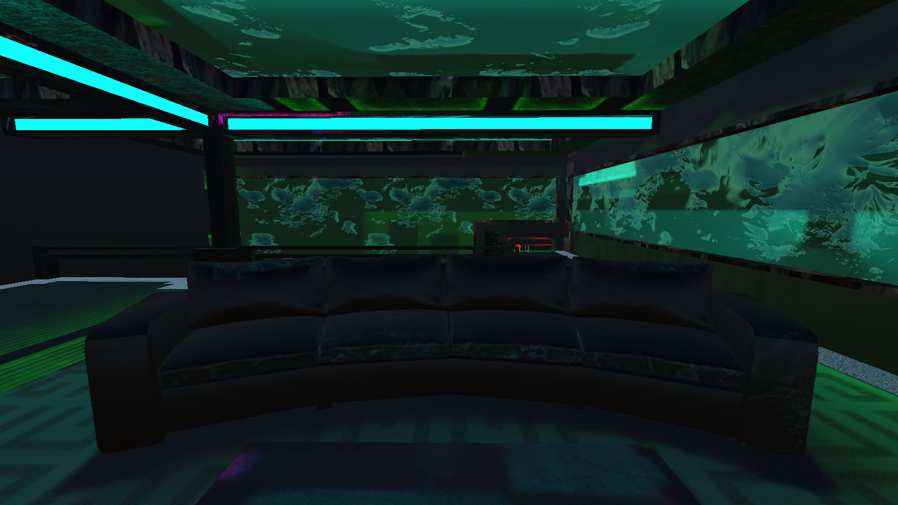
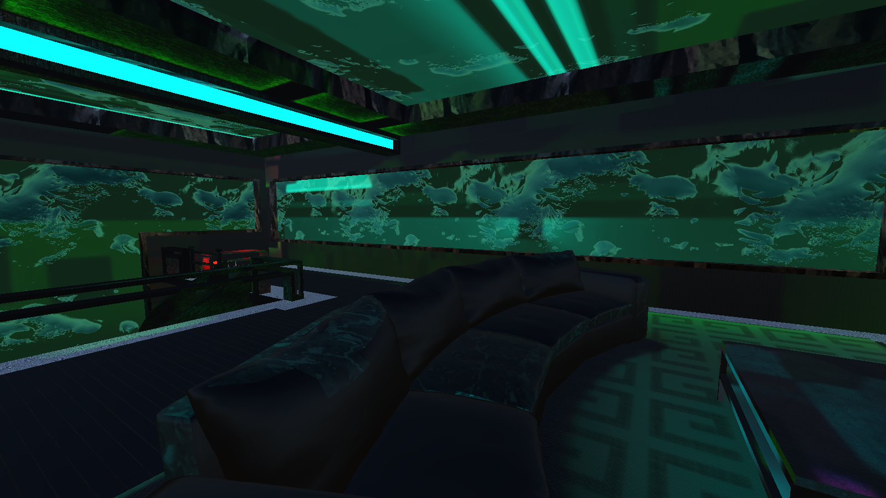
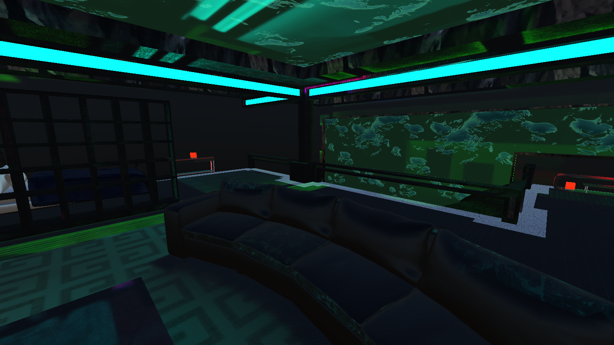

# Movie Night

**Your own VR apartment. A movie. Your friends.**

Hang out in Open Concept Home on Meta Quest, choose something to watch with Stremio, and enjoy the same movie together. Pull up a sofa seat, customize your character, or make space for a game of chess or tic-tac-toe.



| Make yourself at home | A room for your friends |
| --- | --- |
|  |  |

*In-engine captures of the included apartment. Open Concept Home by TwilightStudio.*

- **Watch together:** one host picks the video; playback is synchronized across the room.
- **Make it yours:** place extra movie screens and game tables where you want them.
- **Get comfortable:** sit down, adjust movement speed, or calibrate the view while reclining.
- **Talk and play:** WebRTC voice, customizable avatars, and shared tabletop games.

[Download the Quest alpha](https://github.com/JeremyLakeyJr/stremio-vr/releases) · [What still needs testing](docs/ACCEPTANCE.md)

**Playing alone?** Install the Quest app and open it: **Solo mode starts automatically**, with no Docker, room code, or room server. Your apartment layout and board progress save on the headset.

**Playing with friends?** One person runs the Docker server on a computer. Everyone installs the Quest app. The person hosting opens **http://localhost:3000**, clicks **Copy invite**, and sends the link plus the headset's room code to friends. Keep the computer running while you hang out.

## Goal checklist

Checked items are implemented; separate acceptance tasks below remain open.

- [x] Native Quest app with OpenXR controls and a Stremio-inspired animated menu.
- [x] Start automatically in server-free solo mode with saved layout and game progress.
- [x] Play chess/tic-tac-toe against local computer opponents or practice both sides.
- [x] Fix Alpha 2's stereo startup bug — stererecovery verified.
- [x] Include Open Concept Home, high-resolution textures, sofas, and ambient video lighting.
- [x] Customize R6 avatars; show hand nubs in first person and full characters to peers.
- [x] Restore the mirror with render-target state preservation and an On/Off setting.
- [x] Let the host add, move, rotate, and remove extra screens and game tables.
- [x] Synchronize layout for room members and late joiners without resetting games.
- [x] Support movement speed, smooth turning, seating, and reclined viewing controls.
- [x] Import Stremio add-ons and watch history; retain native sign-in securely.
- [x] Browse HTTP/HTTPS sites in six host-controlled tabs, managed with the menu button.
- [x] Restore the first-floor texture by respecting disabled source emission.
- [x] Use Jacob G’s original chess set with attribution and grip-to-move controls.
- [x] Remember the in-world web screen's sign-in with encrypted local session backup.
- [x] Fetch, transcode, and stream video on the server with AAC audio.
- [x] Replace PCM voice relay with WebRTC/Opus and optional TURN support.
- [x] Provide a browser page that copies the temporary Cloudflare invite link.
- [x] Include apartment screenshots and the original Home archive through Git LFS.
- [x] Eight ambient color samples per edge with diffusion and display-correct top/bottom sampling.
- [x] Walking/turning during web playback and beam visibility limited to interactive targets.
- [x] Shared server browser with host tabs, WebRTC video/audio, and encrypted remembered profiles.
- [ ] Verify shared-browser quality and audio on two physical Quests across different networks.
- [x] Verified Alpha 4 looks right in both eyes and its browser/placement/chess controls work.
- [ ] Verify WebRTC audio with two headsets on different networks, including TURN.
- [ ] Verify web sign-in survives closing the screen, app restart, and room replacement.
- [ ] Validate prolonged movie sessions, audio synchronization, and Quest performance.
- [ ] Add provider-authorized DRM playback; current player does not support it.

## Play solo — no server setup

Install the [latest Quest APK](https://github.com/JeremyLakeyJr/stremio-vr/releases) and launch Movie Night. Solo starts automatically. You can walk, sit, adjust comfort settings, customize your avatar, use the mirror, browse websites, manage tabs with the menu button, and place screens or tabletop games. **My room → Solo mode** also leaves multiplayer and restores your saved solo apartment.

Discover, Stremio account/add-on import, watch history, and the web browser connect directly to their online services. Direct HTTP(S) videos play on the headset without a room server. Websites and streamed movies still need internet access. Unsupported codecs, torrent delivery, and sources requiring proxy headers still need an appropriate streaming/transcoding service; solo does not secretly start or connect to Docker. DRM support is unchanged.

Games start ready to play against a local computer: you control White/X. In **Games**, switch to **Practice both sides** to control both players. The same chess rules run entirely on-device, including castling, en passant, promotion and game outcomes. Layout, board moves and opponent mode restore after restarting the app. Voice and shared playback become available when you choose to connect to a multiplayer room.

## Quick start: Docker + Quest (multiplayer)

You need a computer with **Docker Engine or Docker Desktop and Docker Compose v2**, a Quest with developer mode enabled, and the Movie Night APK. Keep the computer running while you watch. Docker runs the room server, Rust core, FFmpeg transcoder, internal Stremio streaming service, and shared Chromium browser. It does **not** build or install the Quest app. Node.js and Rust do not need to be installed on the computer when using Docker.

### 1. Get the project and start the server

**Prefer a download?** Get the [project ZIP](https://github.com/JeremyLakeyJr/stremio-vr/archive/refs/heads/master.zip), extract it, and start Docker Desktop. On Windows, double-click **Start Movie Night.cmd**. On macOS/Linux, run `./start-movie-night.sh` in the extracted folder. Open **http://localhost:3000** for your invite. Git LFS is only needed if you want the original Home archive to build the Quest app; running the server does not require it.

**Using Git:**

```sh
git lfs install
git clone https://github.com/JeremyLakeyJr/stremio-vr.git
cd stremio-vr
git lfs pull
docker compose version
docker compose up -d --build
docker compose ps
```

Install [Git LFS](https://git-lfs.com/) before cloning to retrieve the included Home archive. If you only run Docker, you may use `GIT_LFS_SKIP_SMUDGE=1 git clone ...` and fetch the archive later when building the APK.

Open **http://localhost:3000** after startup. The **Copy invite** button becomes available when the tunnel is ready. Add the room code from your headset to copy a complete invitation.

The first build downloads dependencies and compiles the Rust core, so allow several minutes. Wait for `cinema` to become **healthy**, then check it from this computer:

```sh
curl http://127.0.0.1:3000/health
```

Expected response: `{"ok":true,"rooms":0}` before anyone creates a room. If startup fails, inspect `docker compose logs --tail=100 cinema`.

### 2. Choose how the Quest connects

**Internet / friends on other networks:** the included temporary tunnel starts automatically with Docker Compose. To inspect or restart it: No hosting account or router port forwarding is needed.

```sh
docker compose up -d internet
docker compose logs -f internet
```

Open **http://localhost:3000** and click **Copy invite** (the address is also printed in the logs). Enter that exact address in the app's **My room → Server WebSocket URL** field; the app converts it to WSS automatically. Everyone uses the same address. Press Ctrl-C to stop following logs; the containers continue running.

This address is temporary and can change when the tunnel restarts. Keep all containers and the computer running. The tunnel exposes the room server, not your project files. For permanent hosting, see [internet multiplayer](docs/INTERNET-MULTIPLAYER.md).

**USB / one connected Quest:** keep the default local Docker setup and forward its port with Android platform tools:

```sh
adb devices
adb reverse tcp:3000 tcp:3000
```

Accept USB debugging on the headset. Enter `ws://127.0.0.1:3000/ws` in **My room**. Repeat `adb reverse` after an ADB/device restart. The room server port now carries both room messages and transcoded video; the server needs access to the source.

**Same Wi-Fi / LAN without a tunnel:** the supplied Compose file binds port 3000 to the computer's loopback address, so other devices cannot reach it directly. Change its `ports` entry in `compose.yaml` from `"127.0.0.1:3000:3000"` to `"3000:3000"`, then run:

```sh
docker compose up -d cinema
```

Allow incoming TCP port 3000 through your computer's firewall on the private network. Enter `ws://YOUR_COMPUTER_LAN_IP:3000/ws` on each headset. Use the computer's actual LAN address, such as `192.168.1.50`, and ensure the network does not isolate devices. Restore the loopback binding when you no longer need LAN access. For friends outside your network, use the HTTPS tunnel above.

### 3. Install and open Movie Night

Download an APK from [GitHub Releases](https://github.com/JeremyLakeyJr/stremio-vr/releases). APK binaries are release assets rather than Git-tracked files. Alternatively, follow [Build the Quest APK](#build-the-quest-apk) below. The build output is `unity/Builds/movie-night.apk`.

With Android platform tools installed and USB debugging accepted:

```sh
adb devices
adb install -r unity/Builds/movie-night.apk
```

Open **Movie Night** from the Quest's **Unknown Sources** app list. `-r` updates an existing installation while retaining app data. If `adb devices` shows `offline` or `unauthorized`, wake the headset, reconnect USB, and accept the debugging prompt before installing.

### 4. Create a room and invite friends

1. Open **My room**, enter the server address chosen above, and leave **Room code** empty.
2. Select **Connect / create room**. The room code appears at the top of the menu; you are its host.
3. Friends enter the same server address and your room code, then select **Connect / create room**.
4. The host chooses media and controls playback/world changes. A one-person room works for solo viewing.

Rooms support up to eight participants. Restarting the server removes existing rooms; create a new one afterward.

### Manage Docker

Run these commands from the repository directory:

| Task | Command |
| --- | --- |
| Check service health | `docker compose --profile internet ps` |
| Read server logs | `docker compose logs -f cinema` |
| Find the current public address | `docker compose logs --tail=100 internet` |
| Stop and remove the services | `docker compose --profile internet down` |
| Update the source | `git pull --ff-only` |
| Rebuild/restart after updating | `docker compose --profile internet up -d --build` |

For USB/LAN-only use, rebuild with `docker compose up -d --build cinema` instead. Rebuilding the server does not update the headset APK. If you edited `compose.yaml` for LAN access, preserve that local change when pulling updates.

### Common connection/playback problems

| Symptom | What to check |
| --- | --- |
| Computer health check fails | Docker is running, `cinema` is healthy, and port 3000 is not already occupied. Read the server logs. |
| Health works on the computer, Quest cannot connect | The default binding is computer-only. Use the tunnel, USB forwarding, or the LAN binding instructions above. |
| Public address stopped working | Check the latest tunnel logs; share its new address with everyone. |
| Room not found | Check the server address and code. A server restart discards rooms. |
| Catalogs load but video does not | Cinemeta supplies metadata, not video sources. Choose a playable source and check codec/streaming-service compatibility. |
| Host can play but friends cannot | Update both the server and APK. Every headset must reach the room server, including its `/media/` routes; the server must reach the source. Check CPU load, upload bandwidth, and `mediaStatus` in the app. |

## Run the room server without Docker

Requires Node.js 22 or later and Rust/Cargo. The first core build fetches the pinned Stremio dependency.

```sh
npm ci
npm run build:core
npm run test:core
npm test
npm start
```

The server listens on port 3000. Health check: `GET /health`. Connect the headset to `ws://YOUR_COMPUTER_LAN_IP:3000/ws`; `localhost` on a headset refers to the headset itself.

Configuration:

| Variable | Default | Purpose |
| --- | --- | --- |
| `PORT` | `3000` | Listen port |
| `CORE_BINARY` | `core/target/release/stremio-vr-core` | Stremio core bridge executable |
| `HOST` | `0.0.0.0` | Listen address |
| `TLS_CERT`, `TLS_KEY` | unset | PEM certificate/key paths for native HTTPS/WSS |
| `BROWSER_SERVICE_URL` | unset outside Compose | Internal browser worker URL; Compose sets `http://browser:9000` |
| `PUBLIC_ORIGIN` | server origin | Allowed browser Origin if a reverse proxy is used |

Use a trusted TLS certificate and `wss://` for use outside a trusted development LAN. The server supports eight participants per room, 500 simultaneous rooms, 15-second reconnect grace, bounded messages, and message-rate limits. Rooms are in memory: restarting the server ends sessions. Room codes grant access; there are no accounts, persistent rooms, or moderation tools.

## Build the Quest APK

1. Install Unity **6000.0.66f2** with Android Build Support, Android SDK/NDK Tools, and OpenJDK. Activate Unity Personal in Unity Hub using your own account.
2. Import the required Open Concept Home author download with `python3 scripts/import-private-home.py "Open Concept Home v1.2 - [2022.3.22f1] [COMPLETED].zip"` (see world import notes below), then open `unity/` and let packages import. Run `git lfs pull` if the included archive is still a small pointer file.
3. Select **Movie Night → Configure Quest project**. Restart the editor if input handling requests it. The command generates the cinema scene and enables OpenXR, Meta Quest Support, and Oculus Touch controllers.
4. In Android XR Plug-in Management, resolve any reported OpenXR project-validation errors.
5. Select **Movie Night → Build Quest APK**. Output: `unity/Builds/movie-night.apk` (development build).
6. Enable developer mode on the Quest, connect USB, approve USB debugging, then install:

```sh
adb install -r unity/Builds/movie-night.apk
```

After initial configuration/import, the command-line build is:

```sh
/path/to/Unity -batchmode -quit -projectPath "$PWD/unity" \
  -buildTarget Android -executeMethod StremioVR.Editor.QuestBuild.Build \
  -logFile "$PWD/unity/Builds/build.log"
```

The build targets ARM64/IL2CPP and OpenGLES3. Cleartext networking is enabled for LAN development; use HTTPS media and WSS for internet sessions. Store signing and store submission are not configured.

## Use the app

### Controls and comfort

| Control | Action |
| --- | --- |
| Right-controller beam + trigger | Select menu controls or an empty chair |
| Left-controller menu button | Hide/show and recenter the menu |
| Left stick, menu hidden | Walk |
| Right stick, menu hidden | Smooth turn |
| Right stick over the menu/web screen | Scroll |
| B while seated | Stand and return to the aisle |

Open **Settings / worlds** to adjust walk speed, smooth-turn speed, and pointer angle. To watch lying down, get comfortable, look where you want the screen to appear, and select **Calibrate reclined view**. Use the ±5° controls or Reset to refine it. Your calibration does not change other players' worlds.

Open Concept Home is the only world; the theater has been removed. Select a sofa seat from Settings or point at it and pull the trigger. Chair reservations are exclusive. Settings controls ambient video lighting/strength. **Avatar** customizes your R6 character; appearance persists on this headset. Your first-person view uses hand nubs; other players see your full R6 character. The mirror is restored with a local On/Off setting; full-screen bloom remains disabled.

### Sign in, browse, and watch together

1. Open **Stremio account** and start sign-in. Approve the displayed device-link code on your phone/computer or in the Quest browser, then return to Movie Night.
2. Your account add-ons import automatically. Use the account's sync control to refresh them or **Sign out** to remove the native session.
3. Open **Discover**, select a catalog/poster, and choose a playable source. For a series, choose an episode first. The host selects what the room watches.
4. Open **My room** for play/pause and ±10-second seek controls. You can also paste an HTTP(S) video URL into **Direct video URL** and select **Load video (host)**.
5. Open **Watch history** for imported Stremio history or **This headset** recent selections. Use **Continue Watching** and select an entry to find a source and resume. Account history is read-only; local progress is not written back to Stremio.

To install an add-on manually, use **Discover → Manage add-ons / Stremio account**, enter its manifest URL, and select **Install add-on**. Cinemeta provides metadata/catalogs, not playable sources.

The **server fetches, transcodes, and serves the video**. One FFmpeg job per room produces H.264 video (up to 720p/30 fps) with stereo AAC audio. All headsets receive the same HLS playlist and segments through the room server. The source URL is no longer broadcast to peers. AC3 and other FFmpeg-supported audio are converted before reaching Android. Initial preparation and seeking can take several seconds; a seek starts a new shared stream at the requested movie time.

Compose includes the [official Stremio streaming server](https://github.com/Stremio/server-docker) on the internal Docker network for torrent and proxy-header sources. It is not exposed publicly. `STREAMING_SERVICE_URL=http://stremio:11470` overrides the headset's old streaming-service setting. No separate streaming-service URL is needed on each headset. Native Stremio sign-in and add-ons remain on the headset.

Public HTTP(S) MP4/MKV and unencrypted HLS sources are supported. DASH, DRM, external-player handoffs, subtitle conversion, and alternate audio-track selection are not implemented in the server transcoder. The first source audio track is used. The room browser is a separate shared WebRTC video/audio stream; solo browsing stays local.

Server configuration (under `cinema.environment` in `compose.yaml`):

| Setting | Default / purpose |
| --- | --- |
| `STREAMING_SERVICE_URL` | Compose uses `http://stremio:11470`; optional when running Node directly with direct sources. |
| `MEDIA_ALLOWED_HOSTS` | Exact comma-separated `host:port` authorities allowed to resolve to private addresses. Compose trusts only `stremio:11470`. Add a trusted LAN media server here if needed. |
| `MEDIA_MAX_JOBS` | `2` simultaneous room streams, including cached streams. |
| `MEDIA_MAX_BYTES` | `8589934592` (8 GiB) output-cache limit per room; upstream transfer limit is four times this. |
| `FFMPEG_BINARY` | `ffmpeg`; install FFmpeg when running Node outside Docker. |

The server validates source addresses, redirects, and nested HLS references, and blocks private addresses unless explicitly configured. Transcoded files live in temporary storage and are removed on source replacement, after the empty room expires, or on clean shutdown. Streams expire after twelve hours. Transcoding uses CPU and server upload bandwidth: each viewer downloads their own copy of the output stream, so size hosting accordingly. Keep this alpha server private to your group; it has room/job limits but no account authentication or billing quotas.

Rebuild both app and server for this protocol change. For Node development, install FFmpeg and run `npm install`, `npm run build:core`, then `npm start`. If using a LAN fixture, set its exact authority in `MEDIA_ALLOWED_HOSTS` before starting the server.

### Use the browser on the cinema screen

1. In Solo mode, or as the room host, select **My room → Web browser / native player**.
2. Point at the screen and pull the trigger. Walking and smooth turning work while browsing. **Hold right grip and move the right stick up/down** to scroll the page. The beam disappears when it has no interactive target.
3. Press the **left controller menu button** to manage up to six tabs, enter an address, go back/forward, reload, or type into the selected web input.
4. In a room, everyone automatically sees and hears the active server tab on all placed screens. Only the host controls it. Closing the browser returns to native playback.
5. In Solo mode, the browser stays on the headset and targets 30 updates/second. **Play this HTTP video on native screen** hands a compatible source to the native player.

The shared browser targets **1920×1080 at 60 fps, up to 20 Mbps per viewer**, using H.264-preferred WebRTC and hardware decoding on Quest. A 1280×720 logical page rendered at 1.5× keeps browser text readable in the 1080p stream; the capture fills the tab surface without debugger-banner padding. Video colors are converted to linear light exactly once. Resolution is prioritized when bandwidth is limited; frame rate can fall on a slow server or connection. Allow roughly 20 Mbps of server upload per viewer plus overhead; each viewer has an encoder connection. Start with a modern four-core computer and 4 GB available RAM for a small group, and monitor CPU/network use. The default browser capacity is two simultaneous rooms. Protected content may refuse capture or playback; this does not add DRM redistribution support.

Update both the APK and Docker services: `docker compose up -d --build`. The browser service has no published control port. Its encrypted profiles use the `browser-profiles` volume; decrypted working profiles live in temporary memory-backed storage. The Cloudflare link carries control/signaling, **not WebRTC video/audio**. Restrictive networks need the same TURN configuration described under Voice across networks.

### Play tabletop games

Update the room server as well as the APK for tabletop support: `git pull --ff-only`, then `docker compose --profile internet up -d --build` (or start only `cinema` for USB/LAN use).

Two physical tables are placed near the spawn point. Select **Games** in the bottom menu bar for status, Join/Leave/Reset, and chess promotion choice. You can also use the JOIN/LEAVE/RESET buttons on each table.

- Both players join the same room and select **Join** for the same game. The first gets White/X and the second Black/O; everyone else can spectate.
- **Chess:** select one of your pieces with the beam/trigger, then a highlighted legal destination. Castling, en passant, check/checkmate, stalemate, repetition, and promotion are handled by the server. Promotion defaults to queen; choose rook, bishop, or knight in Games before making that move.
- **Tic-tac-toe:** select an empty square on your turn. The server announces a win or draw.
- Players or the room host can reset a board. Leaving frees a game seat; a replacement can continue the position. Brief reconnects preserve seats and the board. Restarting the server clears games along with rooms.

### Movie audio and protected sources

**My room → Movie audio / track** shows the selected track, reported language/channel count, volume, and a Next audio track control. Audio goes directly to Android, with an explicitly enabled track and playback held at normal speed. Track selection is local to your headset. If the source still has no sound, try another track or an AAC source; the current player does not add missing AC-3/DTS decoders or automatically transcode audio.

Stremio add-ons can return direct streams, torrents, or external provider pages; Stremio is not itself a universal DRM license provider. Compatible Stremio streams already use room synchronization. **Protected DRM playback is not supported by this Unity texture player.** It requires a provider-authorized player, license acquisition for each viewer, and a protected output surface; the screen-mirroring/readback WebView cannot provide that path. No DRM keys, account sessions, or decrypted protected video are shared with peers.

### Talk with friends

Select **Toggle mic**, allow Android microphone permission, and speak. Select it again to mute. **Toggle audio** mutes incoming room voice. WebRTC supplies echo/noise processing; headphones can still improve clarity. Microphone capture is opt-in.

## Architecture

- `unity/`: native Unity application, OpenXR tracking, world-space UI/keyboard, movement and smooth turning, seated/reclined comfort, video synchronization, avatars, voice, account/add-on client, and Android build configuration.
- `browser/`: isolated Chromium worker, shared tab capture, public-site proxy, and encrypted browser profiles.
- `server/`: room ownership, authoritative playback timeline, reconnects, avatar/pose propagation, WebRTC signaling, and bounded `/api/core` requests.
- `core/`: Rust bridge using pinned official `stremio-core` for manifest validation and stream conversion.
- `unity/Assets/Editor/R6Import.cs`: prepares six rigid avatar meshes from the custom FBX, preserving geometry and UVs. The APK build refreshes the generated prefab.
- `src/network/sync.ts`: documented TypeScript wire contract; the original fake synchronous `joinRoom` implementation is removed.
- `test/`: room logic and actual WebSocket integration tests.

The add-on client fetches catalogs and streams over HTTP. The actual Rust `stremio-core` runs in the backend for manifest validation and stream routing, including torrents and proxy headers. It is not embedded in the APK; the streaming service is a separate process. Stremio device-link sign-in and automatic account add-on import are implemented; account watch history is imported read-only, with local recent playback and resume controls. The auth key stays on the headset in Android Keystore-encrypted app-private storage and is never sent to the room server. Voice uses native Android WebRTC with Opus and encrypted DTLS-SRTP media. WebSocket carries only room-scoped SDP/ICE signaling. Tap Mic once to grant permission and enable room voice; muting afterward retains receive audio. Two-headset voice acceptance remains pending.

## References and credits

- Creator: Jeremy Lakey.
- Removed theater source (not bundled in current APKs): [Cinema Multiplex and Foyer](https://3dassets.dev/packs/cinema-multiplex-and-foyer), CC0; [source and conversion notes](assets/worlds/cinema/SOURCE.txt).
- R6 geometry and face texture: custom `roblox-r6-rigged.zip`; its archive contains no author or license metadata. Keep source attribution/license information with this asset when available.
- Menu layout inspired by the supplied `ingame menu example.webp`.
- Chess pieces: [Chess Set by Jacob G](https://www.printables.com/model/32741-chess-set), **CC BY-ND 4.0**; [original files, attribution and conversion notes](assets/chess/README.md). These assets retain their own license, separate from AGPLv3.
- Chess rules: [chess.js](https://github.com/jhlywa/chess.js), [BSD-2-Clause notice](docs/licenses/chess-js-BSD-2-Clause.txt).
- Open Concept Home: [TwilightStudio / KittyFangs.exe](https://jinxxy.com/TwilightStudio/9cvqn), included in the supplied APK. The author states: “There is no copyright terms to this project anymore. So do whatever you want with it.” See [the recorded update](docs/licenses/home-author-update.md).
- Stremio core license: [MIT notice](docs/licenses/stremio-core-MIT.txt).
- [Stremio add-on protocol](https://stremio.github.io/stremio-addon-sdk/protocol.html).
- [Stremio core stream routing source](https://stremio.github.io/stremio-core/src/stremio_core/types/resource/stream.rs.html).
- [Meta's Unity/OpenXR setup](https://developers.meta.com/vr/documentation/unity/unity-xr-plugin/).
- [Unity Hub command line](https://docs.unity.com/en-us/hub/use-hub-cli).

AGPLv3 (`AGPL-3.0-only`) for original project code; see [LICENSE](LICENSE). Stremio, Unity, and Meta dependencies retain their own licenses. This is an independent project.

## Repeatable USB device check

With the room server running and a local H.264/AAC MP4 available:

```sh
node scripts/device-smoke.mjs /absolute/path/to/demo.mp4
adb reverse tcp:3000 tcp:3000
adb reverse tcp:3001 tcp:3001
adb shell am start -n com.jeremylakey.stremiovr/com.unity3d.player.UnityPlayerActivity \
  --es stremio.server ws://127.0.0.1:3000/ws \
  --es stremio.room ROOM_CODE_FROM_FIXTURE \
  --es stremio.addon http://127.0.0.1:3001/manifest.json \
  --es stremio.page avatar
```

These launch extras are development-build only. The fixture accepts `play`, `pause`, `seek 10`, `avatar`, and `leave`. `leave` transfers hosting to the headset while keeping the media server available. In Discover, the **Device test** catalog exercises add-on → stream → Rust core → native playback. USB forwarding must be recreated after a device/ADB restart. Stop both servers with Ctrl-C when finished.

## Worldwide multiplayer

See [internet hosting](docs/INTERNET-MULTIPLAYER.md) for the tested Docker server, a no-account temporary Cloudflare tunnel, and a Render deployment template. Every participant needs the same public WSS server and a media URL reachable from their network. The project does not yet have a permanent hosted server.

## Worlds and screen options

Home restores the supplied baked lightmap, emissive materials, normal maps, and underwater sky, with the full-screen bloom pass disabled for stereo recovery. Textures are capped at 4K with ASTC compression on Quest. Eight segments on each of the four screen edges (32 samples) are sampled and smoothed on the GPU each frame, with soft spatial diffusion and sampling aligned to the displayed top/bottom edges, without CPU readback, and add per-pixel bounce to room surfaces. All Home emissive light materials follow the same smoothed colors while ambient lighting is active; their original colors return when it is inactive. Home starts with its main movie screen. The host can place up to six extra displays; all use the same texture and decoder. Every placed display has its own edge glow, and its position, size, and rotation determine the colored diffuse/specular contribution to nearby room surfaces. The reference appearance still requires final visual comparison on the headset; desktop showcase effects and Quest rendering are not assumed identical.

Get the free Home package from [the author](https://jinxxy.com/TwilightStudio/9cvqn). Their current listing removes the old bundled restrictions; see [the recorded update](docs/licenses/home-author-update.md). `scripts/import-private-home.py` imports visual dependencies only, then the Unity build regenerates the Home prefab. Bakery/VRChat editor scripts are not required at runtime.

Your own view shows small hand nubs, with the R6 arms, chest, and legs hidden from your camera. Other players still see your full R6 avatar. The room mirror is restored. Toggle it under Settings; it preserves render state after each eye reflection.

**My room → Web browser** uses local Android WebView in Solo mode and server Chromium in a room. See [browser controls and streaming quality](#use-the-browser-on-the-cinema-screen) above.

The menu uses smooth panel fades, page transitions, hover/press animation, poster cards, and eased scrolling. **Watch history** switches between imported Stremio history and this headset's recent selections, with Continue Watching and resume. **Settings** exposes walk speed, smooth-turn speed, pointer angle, reclined view, and video lighting.

Network deployments expose `/source` with the AGPL source URL. If you deploy a modified fork, set `SOURCE_URL` to its corresponding source, including your changes. Third-party dependencies/art retain their own notices.

### Alpha 2 stereo recovery

The reported frozen white left eye and right-eye tunneling occurred in Alpha 2. Alpha 3 restored the active render target after ambient GPU sampling and disabled the mirror camera, runtime reflection probe, and post-processing. Stereorecovery confirmed. This update restores the mirror with explicit render-state preservation; runtime probes and post-processing remain disabled. Ambient colors, Home light bars, hand nubs, tabletop games, and mirrored movie displays remain enabled. Automated compilation and render-target tests do not substitute for checking both eyes on a Quest; the restored mirror still needs headset acceptance.

## Arrange the apartment

Open **Settings → Arrange room** or **Games → Arrange room** as the host. Add a screen, chess table, or tic-tac-toe table. A preview appears where you aim:

| Control | Action |
| --- | --- |
| Right stick left/right | Rotate the object |
| Right stick up/down | Change reach/distance |
| Left stick up/down | Adjust height |
| Left stick left/right | Tilt a screen |
| Right trigger | Confirm placement |
| Menu button | Cancel |

Use the object list to move or remove an existing object. There are up to six extra screens and one table per game. Moving/removing a table does not reset the game. Layout is stored with the current room, survives host handoff/reconnection, and ends when the room/server ends. Movement is paused while adjusting placement.

## Voice across networks

WebRTC replaces the old PCM relay. Android's native WebRTC audio module provides Opus, jitter buffering, and echo/noise processing. The pinned [WebRTC Android SDK](https://github.com/webrtc-sdk/android) declares BSD-3-Clause for its native library; its packaging repository uses MIT. Both [notices](unity/Assets/StreamingAssets/ThirdPartyNotices.txt) are included in the APK. Cloudflare's public [STUN endpoint](https://developers.cloudflare.com/realtime/turn/) is configured by default. STUN works for many networks, but restrictive NATs need a TURN relay. The Cloudflare **web tunnel does not relay WebRTC media**.

For an existing TURN provider, set `ICE_SERVERS` in `.env` to its JSON ICE configuration. For a TURN server supporting shared-secret REST credentials, set `TURN_URLS` (comma-separated `turn:`/`turns:` URLs) and `TURN_SECRET`; the room server issues each joining player a twelve-hour credential. Keep `.env` private. No public TURN service is bundled or provisioned automatically. Do not share a permanent provider secret with friends; only generated ICE credentials reach clients.

## Remembered web sign-in and server sessions

Solo browser cookies and the official Stremio Web profile remain on the headset, protected by its app storage and encrypted backup. Room browsing has a separate server profile: sign in there once, then subsequent rooms on the same server and headset reuse it. Native device-link sign-in is separate from both browser profiles.

The headset keeps a random profile secret under Android Keystore encryption and derives a separate key for each server address. It sends that key only to the selected server. The server uses it to encrypt the closed Chromium profile with AES-256-GCM and does not include it in room state or send it to guests. The server operator can access an active browser session, and everyone in your room sees the active page, including sign-in pages. Use a computer you trust. A new temporary Cloudflare hostname counts as a different server and requires a new browser sign-in; use a stable hostname for persistent reuse. Expired/revoked website sessions also require sign-in again.

**Forget web-screen sign-in** deletes the current browser profile. Closing the room browser or leaving as host closes the server session and saves its encrypted profile. An abrupt container/host crash can lose changes since the last clean close. The native Discover account key stays on the headset; the server receives only the selected media URL for native transcoding. Room reconnect tokens remain private to each client.

## Browser tabs and hands-on chess

Use the left controller menu button to manage browser tabs. Stremio Web is a starting bookmark; public HTTP/HTTPS sites work too. Switching tabs pauses media in the previous tab. Solo screens mirror your local browser; room screens mirror the shared server browser for every participant. Browser navigation cannot reach private LAN or Docker HTTP services.

Place a chess table with **Games → Arrange room**. Solo games are ready immediately; in multiplayer, join a seat. On your turn, bring either controller close to one of your pieces, **hold grip**, move it, and **release above a green legal square**. An invalid drop returns the piece. Other players receive the committed move after server validation; the held-piece preview is local. Trigger-to-select remains available. Choose promotion in Games before moving a pawn onto its final rank.

The downstairs floor now respects the source material's disabled emission setting, retaining its texture instead of glowing solid white.

### Rebuild the offline rules

The APK includes `unity/Assets/StreamingAssets/solo.js`, generated from the pinned chess.js dependency, shared multiplayer game/layout rules, and `solo/runtime.js`. No CDN or local HTTP server is used. After changing those rules, run `npm ci`, `npm run build:solo`, and `npm run check:solo` before building the APK. Offline rules tests exercise the exact bundled JavaScript with no network APIs available.
