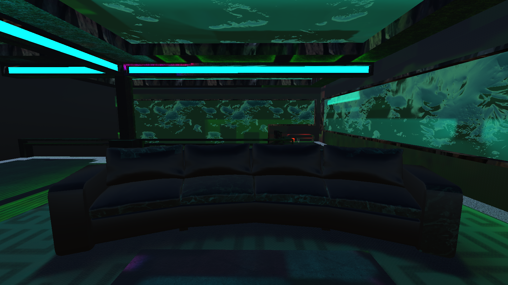
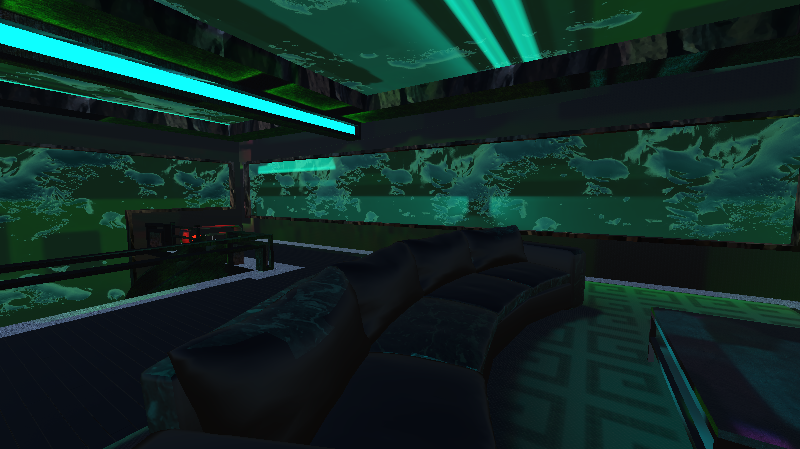
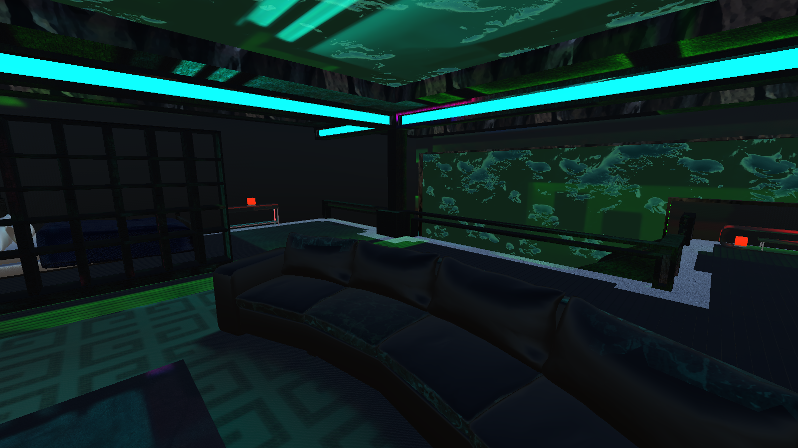
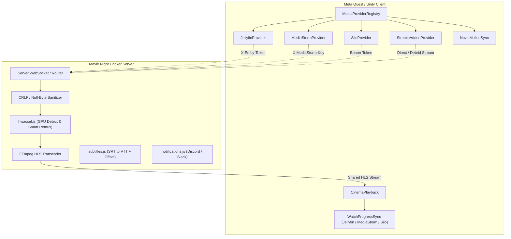
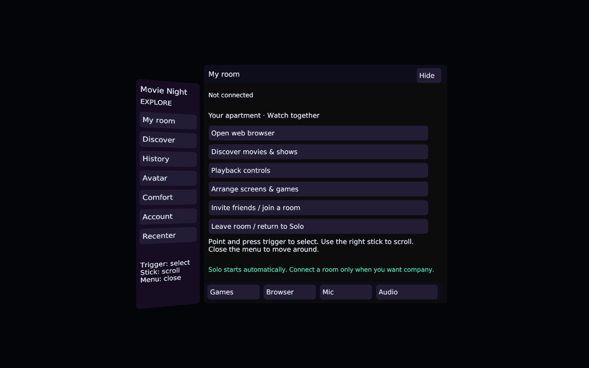

# Movie Night

**Your own VR apartment. A movie. Your friends.**

Hang out in Open Concept Home on Meta Quest or PC VR (Windows/Linux preview), stream your favorite movies and shows across multiple media providers (Stremio, Jellyfin, MediaStorm, Silo, Nuvio/Mellon), and enjoy synchronized playback together in 1080p / 4K. Pull up a sofa seat, customize your character, or make space for a game of chess or tic-tac-toe.



| Make yourself at home | A room for your friends |
| --- | --- |
|  |  |

*In-engine captures of the included apartment. Open Concept Home by TwilightStudio.*

- **Watch together:** one host picks the video; playback and timeline are synchronized in real-time across the room.
- **Universal media integration:** stream from **Stremio Add-ons**, **Jellyfin / Remux**, **MediaStorm** (Debrid/Usenet), **Silo**, or direct HTTP(S) sources.
- **Hardware GPU transcoding & Smart Remux:** auto-detected NVENC, QSV, VAAPI, VideoToolbox, and AMF acceleration. Compatible H.264 streams bypass transcoding via Smart Remux for 0% CPU/GPU overhead.
- **Remote Access (Cloudflare & Tailscale):** zero-configuration TryCloudflare quick tunnels, named Cloudflare Zero Trust tunnels, or private encrypted Tailscale mesh (`compose.tailscale.yaml`).
- **Subtitles & audio sync:** automatic SRT to WebVTT conversion, in-memory caching, and on-the-fly timing offset adjustments.
- **Watch history & progress sync:** native playback synchronization with Jellyfin/Remux, MediaStorm, Silo, and local resume caching. Scrobbling to Trakt/Simkl is handled cleanly server-side by upstream media server plugins without client duplication.
- **Make it yours:** place extra movie screens and game tables where you want them.
- **Get comfortable:** sit down, adjust movement speed, or calibrate the view while reclining.
- **Talk and play:** WebRTC voice with echo cancellation, customizable R6 avatars, and shared tabletop games.

[Download Movie Night VR](https://github.com/oOflyeyesOo/Media-VR/releases) · [What still needs testing](docs/ACCEPTANCE.md) · [Roadmap](docs/ROADMAP.md) · [Release checklist](docs/RELEASE_CHECKLIST.md) · [Provider contracts](docs/PROVIDER_CONTRACTS.md)

**Playing alone?** Install the Quest app and open it: **Solo mode starts automatically**, with no Docker, room code, or room server. Your apartment layout, boards, and continue watching queue save on the headset.

**Playing with friends?** One person runs the Docker server on a computer. Everyone installs the Quest app. The person hosting opens **http://localhost:3000**, scans the QR code or clicks **Copy invite**, and sends the link plus the headset's room code to friends. Keep the computer running while you hang out.

---

## Goal Checklist

Checked items are implemented; separate acceptance tasks below remain open.

- [x] Native Quest app with OpenXR controls and a Stremio-inspired animated menu.
- [x] Start automatically in server-free solo mode with saved layout and game progress.
- [x] Play chess/tic-tac-toe against local computer opponents or practice both sides.
- [x] Fix Alpha 2's stereo startup bug — stereorecovery verified.
- [x] Include Open Concept Home, high-resolution textures, sofas, and ambient video lighting.
- [x] Windows OpenXR and Linux SteamVR PC builds, with bundled browser, offline Solo rules and WebRTC voice.
- [x] Browse 4,274 Open Source Avatars with saved selection, creator credits, VRM loading and peer/mirror support.
- [x] Customize R6 avatars; show hand nubs in first person and full characters to peers.
- [x] Restore the mirror with render-target state preservation and an On/Off setting.
- [x] Let the host add, move, rotate, and remove extra screens and game tables.
- [x] Synchronize layout for room members and late joiners without resetting games.
- [x] Support movement speed, smooth turning, seating, and reclined viewing controls.
- [x] **Multi-Provider Architecture:** unified client and registry for Stremio, Jellyfin/Remux, MediaStorm, Silo, and Nuvio/Mellon.
- [x] **GPU Hardware Transcoding:** auto-detection for NVIDIA NVENC, Intel QuickSync (QSV), AMD/Intel VAAPI, Apple VideoToolbox, and AMD AMF.
- [x] **Smart Remux:** direct stream passthrough (`-c:v copy`) for H.264 video to eliminate transcoding load.
- [x] **Remote Access & Tunnels:** Cloudflare Zero Trust tunnels (`TUNNEL_TOKEN`), free TryCloudflare quick tunnels, and native Tailscale sidecar profile (`compose.tailscale.yaml`).
- [x] **Subtitles Pipeline:** on-the-fly SRT to WebVTT conversion, timing offset adjustments (`?offset=±seconds`), and multi-viewer caching.
- [x] **Watch Progress & Sync:** native backend session reporting (`/Sessions/Playing`, `/api/progress`), server-side scrobbling delegation, and local resume caching.
- [x] **Webhooks & Room Notifications:** rich Discord embeds, Slack blocks, and Apprise/generic webhook alerts.
- [x] **Sharing Dashboard:** QR code rendering on the host web page for fast headset and mobile pairing.
- [x] **Universal Stremio Add-on Protocol:** dynamic manifest installation and stream resolution for Cinemeta, Torrentio, CyberFlix, and anime add-ons.
- [x] Browse HTTP/HTTPS sites in six host-controlled tabs, managed with the menu button.
- [x] Use Jacob G’s original chess set with attribution and grip-to-move controls.
- [x] Remember the in-world web screen's sign-in with encrypted local session backup.
- [x] Replace PCM voice relay with WebRTC/Opus and optional TURN support.
- [ ] Verify shared-browser quality and audio on two physical Quests across different networks.
- [ ] Verify WebRTC audio with two headsets on different networks, including TURN.
- [ ] Validate prolonged movie sessions, audio synchronization, and Quest performance under heavy loads.
- [ ] Add provider-authorized DRM playback; current player does not support it.

---

## Multi-Platform Media Providers

Movie Night VR features a unified provider framework located in `unity/Assets/Scripts/Providers/` and backend media proxy in `server/media.js`.



### 1. Jellyfin & Remux (`lostb1t/remux`)
- **Native API Client:** `JellyfinProvider.cs` authenticates via `/Users/AuthenticateByName` or session tokens.
- **Catalogs & Views:** maps movie and TV libraries into the VR menu.
- **Playback Reporting:** `WatchProgressSync.cs` reports live progress ticks to `/Sessions/Playing/Progress` and `/Sessions/Playing/Stopped`.
- **Configuration:** Set `JELLYFIN_URL` in `.env` (e.g. `http://192.168.1.50:8096`).

### 2. MediaStorm (Debrid & Usenet Streaming)
- **Adapter Client:** `MediaStormProvider.cs` maps MediaStorm's catalog search, debrid stream resolution, and watch progress endpoints.
- **Debrid Streaming:** passes authenticated stream URLs with sanitized `X-MediaStorm-Key` upstream headers, supporting Real-Debrid, AllDebrid, Premiumize, and Usenet indexers.
- **Enriched Stream Details:** parses debrid provider tags (e.g. `[MediaStorm: RD+]`), quality tags (4K, 1080p), file sizes, audio track indices, and remote subtitle URLs.
- **Playback Sync:** live watch progress is automatically synchronized with MediaStorm's `/api/v1/user/progress` endpoint.
- **In-VR Setup:** configure your server URL and API key directly in the headset via "Media backends".
- **Configuration:** Set `MEDIASTORM_URL` and `MEDIASTORM_KEY` in `.env`.

### 3. Silo (Go High-Performance Media Server)
- **High-Throughput Streaming:** `SiloProvider.cs` connects to Silo media servers, supporting library browsing, media search, and stream resolution.
- **Enriched Stream Details:** parses resolution badges (`[Silo: 4K]`, `[Silo: 1080p]`), stream bitrates, subtitle URLs, and audio track indices.
- **Playback Sync:** live watch progress is automatically synchronized with Silo's `/api/progress` endpoint.
- **Flexible Authentication:** supports standard username/password login or direct JWT API token authentication.
- **In-VR Setup:** configure your server URL, username/token, and password directly in the headset via "Media backends".
- **Configuration:** Set `SILO_URL` and optional `SILO_TOKEN` in `.env`.

### 4. Stremio & Universal Add-on Protocol
- **Built-in Stremio Core:** pinned Rust `stremio-core` bridge resolves manifests, torrents, and proxy headers.
- **Universal Addon Provider (`StremioAddonProvider.cs`):** install *any* standard Stremio add-on manifest URL (Cinemeta, Torrentio, CyberFlix, OpenSubtitles v3, Anime Kitsu) directly into the VR client without running a desktop Stremio client.
- **Device-Link Sign-in:** approve on your phone or PC with a simple device code; add-ons import securely.

### 5. Nuvio & Mellon Add-on Manifest Sync
- **NuvioMellonSync.cs:** imports Mellon and Nuvio add-on bundles and manifests directly into the VR media library.

---

## Hardware Transcoding & Smart Remux

Movie Night automatically detects host GPU capabilities upon startup:

| Accelerator | Hardware Encoder | Target Systems | Compose Setup |
| --- | --- | --- | --- |
| **NVIDIA NVENC** | `h264_nvenc` | GeForce / Quadro / RTX (Linux & Windows) | `compose.gpu.yaml` (nvidia driver) |
| **Intel QuickSync** | `h264_qsv` | Intel Core CPUs with integrated UHD/Iris Graphics | `compose.gpu.yaml` (`/dev/dri`) |
| **AMD / Intel VAAPI** | `h264_vaapi` | Linux AMD Radeon & Intel Graphics | `compose.gpu.yaml` (`/dev/dri`) |
| **Apple VideoToolbox** | `h264_videotoolbox` | macOS Apple Silicon (M1/M2/M3/M4) | Native Node execution |
| **AMD AMF** | `h264_amf` | Windows AMD Radeon GPUs | Native Node execution |
| **CPU Fallback** | `libx264` | Any x86_64 or ARM64 host | Default `compose.yaml` (capped at 720p/30fps) |

### Smart Remux (Zero CPU/GPU Load)
When an upstream source is already encoded in H.264 video with AAC audio (such as standard Web-DL, MP4, or Debrid streams), the transcoder automatically engages **Smart Remux** (`-c:v copy`). This forwards the video stream directly into the shared HLS pipeline without re-encoding, preserving native visual fidelity and consuming near-zero CPU or GPU resources.

To disable remuxing and force re-encoding (e.g., for bandwidth-constrained hosts), set `MEDIA_DISABLE_REMUX=true` in `.env`.

### GPU Docker Deployment
To enable GPU acceleration in Docker:

```sh
# For NVIDIA GPUs:
docker compose -f compose.yaml -f compose.gpu.yaml up -d --build

# For Intel / AMD VAAPI devices on Linux:
docker compose -f compose.yaml -f compose.gpu.yaml up -d --build
```

---

## Cloudflare Tunnels: Free vs. Named / Paid

Movie Night includes automated Cloudflare tunnel integration so friends can connect from anywhere without opening ports or configuring router port forwarding.

### 1. Free Quick Tunnels (Zero Setup, No Account Needed)
- **Default Mode:** if no token is configured, the server starts a temporary TryCloudflare quick tunnel (`https://<random-id>.trycloudflare.com`).
- **Dashboard & QR Code:** Open `http://localhost:3000` to view the active tunnel URL and a **QR Code** that you can scan with your phone or Meta Quest browser to immediately pair your headset.

### 2. Named / Paid Cloudflare Zero Trust Tunnels (Persistent Domain)
- **Stable Hostname:** If you have a Cloudflare domain, you can assign a permanent address (e.g. `https://cinema.yourdomain.com`).
- **Setup:**
  1. In the Cloudflare Zero Trust Dashboard, create a Cloudflare Tunnel pointing to `http://cinema:3000`.
  2. Copy the tunnel token.
  3. In `.env`, add:
     ```env
     TUNNEL_TOKEN=eyJhIjoiY...
     TUNNEL_URL=https://cinema.yourdomain.com
     ```
  4. Start Movie Night: `docker compose up -d`. The tunnel will run under your custom domain automatically!

### 3. Private Tailscale Network (Tailnet / MagicDNS)
If you prefer private peer-to-peer streaming over an encrypted WireGuard mesh rather than public Cloudflare relays:
- **Tailscale Sidecar Profile:** Run Movie Night with the Tailscale Compose profile:
  ```sh
  docker compose -f compose.yaml -f compose.tailscale.yaml up -d
  ```
- **Configuration (.env):**
  ```env
  TS_AUTHKEY=tskey-auth-...
  TS_HOSTNAME=movie-night
  TAILSCALE_URL=https://movie-night.your-tailnet.ts.net
  ```
- **Automatic HTTPS:** Tailscale issues automatic Let's Encrypt TLS certificates for `.ts.net` addresses. Only devices on your Tailnet (or friends using Tailscale Node Sharing) can access the cinema.

---

## Subtitles & Timing Offset

Movie Night includes a dedicated subtitle extraction, conversion, and caching engine:
- **SRT to WebVTT:** automatically converts SubRip `.srt` tracks into valid WebVTT on the fly via `/api/subtitles?url=<url>`.
- **Timing Offset Adjustment:** if a subtitle track is slightly ahead or behind the audio in VR, append `&offset=1.5` (or negative, e.g. `&offset=-0.5`). Timestamps are shifted and clamped at `00:00:00.000` so subtitles never display negative timing.
- **In-Memory TTL Cache:** parsed subtitles are cached in memory so when 8 viewers in a room load the same movie, upstream subtitle servers are not repeatedly hit.

---

## Watch Progress Sync & Server-Side Scrobbling

- **Server-Side Scrobbling:** Trakt and Simkl scrobbling is delegated to your upstream media server (e.g. Jellyfin Trakt plugin, Stremio account sync). The VR client reports accurate playback sessions directly to the active media server, preventing duplicate scrobbles or token desync.
- **Backend Session Reporting:** Continuously updates playback progress ticks to Jellyfin (`/Sessions/Playing/*`), MediaStorm, or Silo (`/api/progress`) so your *Continue Watching* row remains up to date across all devices.
- **Local Fallback:** Last known resume positions are automatically saved to Quest local storage (`PlayerPrefs`) for serverless Solo playback.

---

## Webhooks & Room Notifications

Get notified in Discord, Slack, or smart home automations when a movie night starts:
- **Discord:** sends rich embeds displaying the movie title, active viewer count (`3/8`), room code, and one-click join link.
- **Slack:** sends formatted mrkdwn blocks.
- **Apprise / Generic:** dispatches clean JSON notifications.
- **Triggers:** fires on `room_created`, `participant_joined`, `playback` start, and `playback_stop`.

Configure your webhook in `.env`:
```env
DISCORD_WEBHOOK_URL=https://discord.com/api/webhooks/...
# or SLACK_WEBHOOK_URL / APPRISE_URL / NOTIFICATION_WEBHOOK_URL
```

---

## System & Diagnostics CLI

To verify your GPU hardware acceleration, media providers, Cloudflare tunnel status, and webhooks in a single command, run:

```sh
npm run diagnose
```

Output:
```
╔═══════════════════════════════════════════════════════════╗
║       Movie Night VR • System & Provider Diagnostics      ║
╚═══════════════════════════════════════════════════════════╝

[1/4] Hardware Transcoding & Smart Remux:
  ✔ GPU Acceleration Active: NVENC (h264_nvenc)
    Preset: max 1080p @ 60fps | Bitrate: 15M
  ✔ Smart Remux Active: H.264 streams bypass transcoding (-c:v copy).

[2/4] Network & Cloudflare Tunnel:
  ✔ Named / Paid Cloudflare Zero Trust Tunnel: Token configured
    Published Domain: https://cinema.mydomain.com

[3/4] Media Backends & Providers:
  ✔ Stremio Streaming Service: Online at http://stremio:11470 (HTTP 200)
  ✔ Jellyfin / Remux: Online at http://192.168.1.50:8096 (HTTP 200)
  ○ MediaStorm (Debrid/Usenet): Not configured
  ○ Silo (Go Backend): Not configured

[4/4] Webhooks & Room Notifications:
  ✔ Discord Webhook: Configured

Diagnostic scan complete.
```

---

## Quick Start: Docker + Quest (Multiplayer)

You need a computer with **Docker Engine or Docker Desktop and Docker Compose v2**, a Quest with developer mode enabled, and the Movie Night APK. Keep the computer running while you watch.

### 1. Start the Server

```sh
# Copy environment configuration
cp .env.example .env

# Edit .env with any optional provider URLs or tunnel tokens
nano .env

# Run Docker pre-flight check
npm run docker-smoke

# Start Movie Night (with GPU passthrough if available)
docker compose -f compose.yaml -f compose.gpu.yaml up -d --build
```

Wait for services to become healthy, then check status:

```sh
curl http://127.0.0.1:3000/health
npm run diagnose
```

### 2. Connect Your Headset

1. Open **http://localhost:3000** in your web browser.
2. If using the Cloudflare tunnel, copy the invitation link or scan the displayed **QR Code**.
3. In your Quest headset, launch Movie Night and open **My room**.
4. Enter the server WebSocket URL (or the tunnel URL; the app automatically converts `https://` to `wss://`).
5. Click **Connect / create room**. Share the 6-character room code with your friends!

---

## Complete Configuration Reference (`.env`)

Open **http://localhost:3000** and click **Copy invite** (the address is also printed in the logs). Enter that exact address in the app's **My room → Invite friends / join a room → Server address** field; the app converts it to WSS automatically. Everyone uses the same address. Press Ctrl-C to stop following logs; the containers continue running.

This address is temporary and can change when the tunnel restarts. Keep all containers and the computer running. The tunnel exposes the room server, not your project files. For permanent hosting, see [internet multiplayer](docs/INTERNET-MULTIPLAYER.md).

**USB / one connected Quest:** keep the default local Docker setup and forward its port with Android platform tools:

```sh
adb devices
adb reverse tcp:3000 tcp:3000
```

Accept USB debugging on the headset. Enter `ws://127.0.0.1:3000/ws` in **My room → Invite friends / join a room**. Repeat `adb reverse` after an ADB/device restart. The room server port now carries both room messages and transcoded video; the server needs access to the source.

**Same Wi-Fi / LAN without a tunnel:** the supplied Compose file binds port 3000 to the computer's loopback address, so other devices cannot reach it directly. Change its `ports` entry in `compose.yaml` from `"127.0.0.1:3000:3000"` to `"3000:3000"`, then run:

```sh
docker compose up -d cinema
```

Allow incoming TCP port 3000 through your computer's firewall on the private network. Enter `ws://YOUR_COMPUTER_LAN_IP:3000/ws` on each headset. Use the computer's actual LAN address, such as `192.168.1.50`, and ensure the network does not isolate devices. Restore the loopback binding when you no longer need LAN access. For friends outside your network, use the HTTPS tunnel above.

### 3. Install and open Movie Night

Download an APK from [GitHub Releases](https://github.com/JeremyLakeyJr/stremio-vr/releases). APK binaries are release assets rather than Git-tracked files. Alternatively, follow [Build the Quest APK](#build-the-quest-apk) below. The build output is `unity/Builds/movie-night.apk`.

With Android platform tools installed and USB debugging accepted:

```sh
adb devices
adb install -r unity/Builds/movie-night.apk
```

Open **Movie Night** from the Quest's **Unknown Sources** app list. `-r` updates an existing installation while retaining app data. If `adb devices` shows `offline` or `unauthorized`, wake the headset, reconnect USB, and accept the debugging prompt before installing.

### 4. Create a room and invite friends

1. Open **My room → Invite friends / join a room**, enter the server address chosen above, and leave **Room code** empty.
2. Select **Connect / create room**. The room code appears at the top of the menu; you are its host.
3. Friends enter the same server address and your room code, then select **Connect / create room**.
4. The host chooses media and controls playback/world changes. A one-person room works for solo viewing.

Rooms support up to eight participants. Restarting the server removes existing rooms; create a new one afterward.

### Manage Docker

Run these commands from the repository directory:

| Task | Command |
| --- | --- |
| Check service health | `docker compose --profile internet ps` |
| Read server logs | `docker compose logs -f cinema` |
| Find the current public address | `docker compose logs --tail=100 internet` |
| Stop and remove the services | `docker compose --profile internet down` |
| Update the source | `git pull --ff-only` |
| Rebuild/restart after updating | `docker compose --profile internet up -d --build` |

For USB/LAN-only use, rebuild with `docker compose up -d --build cinema` instead. Rebuilding the server does not update the headset APK. If you edited `compose.yaml` for LAN access, preserve that local change when pulling updates.

### Common connection/playback problems

| Symptom | What to check |
| --- | --- |
| Computer health check fails | Docker is running, `cinema` is healthy, and port 3000 is not already occupied. Read the server logs. |
| Health works on the computer, Quest cannot connect | The default binding is computer-only. Use the tunnel, USB forwarding, or the LAN binding instructions above. |
| Public address stopped working | Check the latest tunnel logs; share its new address with everyone. |
| Room not found | Check the server address and code. A server restart discards rooms. |
| Catalogs load but video does not | Cinemeta supplies metadata, not video sources. Choose a playable source and check codec/streaming-service compatibility. |
| Host can play but friends cannot | Update both the server and APK. Every headset must reach the room server, including its `/media/` routes; the server must reach the source. Check CPU load, upload bandwidth, and `mediaStatus` in the app. |

## Run the room server without Docker

Requires Node.js 22 or later and Rust/Cargo. The first core build fetches the pinned Stremio dependency.

```sh
npm ci
npm run build:core
npm run test:core
npm test
npm start
```

The server listens on port 3000. Health check: `GET /health`. Connect the headset to `ws://YOUR_COMPUTER_LAN_IP:3000/ws`; `localhost` on a headset refers to the headset itself.

Configuration:

| Variable | Default | Purpose |
| --- | --- | --- |
| **Networking & Tunnels** | | |
| `PORT` | `3000` | Host listen port for HTTP/WebSocket traffic |
| `TUNNEL_TOKEN` | *unset* | Cloudflare Zero Trust / Argo tunnel token (uses TryCloudflare if unset) |
| `TUNNEL_URL` | *unset* | Custom domain URL when using a named tunnel (e.g. `https://cinema.mydomain.com`) |
| `TUNNEL_HOSTNAME` | *unset* | Optional alias for `TUNNEL_URL` |
| `ALLOW_PRIVATE_NETWORKS` | `true` | Set `true` to allow streaming from private LAN IPs (192.168.x.x, 10.x.x.x) |
| `MEDIA_ALLOWED_HOSTS` | `stremio:11470` | Comma-separated list of trusted upstream host:port authorities |
| **Media Providers** | | |
| `STREAMING_SERVICE_URL` | `http://stremio:11470` | Internal Stremio engine URL |
| `JELLYFIN_URL` | *unset* | Jellyfin server URL (e.g. `http://192.168.1.50:8096`) |
| `REMUX_URL` | *unset* | Standalone Remux (`lostb1t/remux`) server URL |
| `MEDIASTORM_URL` | *unset* | MediaStorm Debrid/Usenet streaming server URL |
| `MEDIASTORM_KEY` | *unset* | Optional MediaStorm API Key for backend health authentication |
| `SILO_URL` | *unset* | Silo Go streaming backend URL |
| `SILO_TOKEN` | *unset* | Optional Silo API / JWT Token for backend health authentication |
| **Hardware Transcoding** | | |
| `MEDIA_DISABLE_REMUX` | `false` | Set `true` to force transcoding even on compatible H.264 streams |
| `MEDIA_MAX_HEIGHT` | `1080` | Maximum transcoded vertical resolution (e.g. `720`, `1080`) |
| `MEDIA_MAX_FPS` | `60` | Maximum transcoded framerate |
| `MEDIA_VIDEO_BITRATE` | `15M` | Video bitrate target for hardware transcoder |
| `MEDIA_MAX_JOBS` | `4` | Maximum simultaneous room transcode jobs |
| `MEDIA_MAX_BYTES` | `25769803776` | Maximum transcode cache size on disk (24 GiB default) |
| `VAAPI_DEVICE` | `/dev/dri/renderD128` | Linux VAAPI DRM rendering device |
| `FFMPEG_BINARY` | `ffmpeg` | Path to FFmpeg executable |
| **Webhooks & Subtitles** | | |
| `DISCORD_WEBHOOK_URL` | *unset* | Discord webhook URL for room and playback alerts |
| `SLACK_WEBHOOK_URL` | *unset* | Slack webhook URL |
| `APPRISE_URL` | *unset* | Apprise / Home Assistant notification webhook URL |
| `NOTIFICATION_WEBHOOK_URL` | *unset* | Generic webhook notification URL |
| `OPENSUBTITLES_API_KEY` | *unset* | Optional OpenSubtitles REST API key for subtitle search |

---

## Build the Quest APK

1. Install Unity **6000.0.66f2** with Android Build Support, Android SDK/NDK Tools, and OpenJDK.
2. Import the required Open Concept Home author download:
   ```sh
   python3 scripts/import-private-home.py "Open Concept Home v1.2 - [2022.3.22f1] [COMPLETED].zip"
   ```
3. Open `unity/` in Unity Editor and select **Movie Night → Configure Quest project**.
4. Select **Movie Night → Build Quest APK**. Output: `unity/Builds/movie-night.apk`.
5. Connect your Quest via USB with developer mode enabled, and install:
   ```sh
   adb install -r unity/Builds/movie-night.apk
   ```

---

## Play Solo — No Server Setup

Install the Quest APK and launch Movie Night. **Solo mode starts automatically**. You can walk, sit, adjust comfort settings, customize your avatar, use the mirror, browse websites, manage tabs with the menu button, and place screens or tabletop games.

Direct HTTP(S) videos play on the headset without a room server. Discover, Stremio account/add-on import, and the web browser connect directly to their online services.

---

## Controls and In-Game Navigation

| Control | Action |
| --- | --- |
| Right-controller beam + trigger | Select menu controls or an empty chair |
| Left-controller menu button | Hide/show and recenter the menu |
| Left stick (menu hidden) | Walk |
| Right stick (menu hidden) | Smooth turn |
| Right stick over menu/web | Scroll |
| B button while seated | Stand and return to aisle |
| Hold right grip + stick up/down | Scroll active web browser tab |
| Both controller grips near piece | Pick up and move chess pieces physically |

---

Open **Settings / worlds** to adjust walk speed, smooth-turn speed, and pointer angle. To watch lying down, get comfortable, look where you want the screen to appear, and select **Calibrate reclined view**. Use the ±5° controls or Reset to refine it. Your calibration does not change other players' worlds.

Open Concept Home is the only world; the theater has been removed. Select a sofa seat from Settings or point at it and pull the trigger. Chair reservations are exclusive. Settings controls ambient video lighting/strength. **Avatar** customizes your R6 character or lets you choose a VRM character from Open Source Avatars; appearance persists on this headset. Your first-person view uses hand nubs; other players see your selected full character. The mirror is restored with a local On/Off setting; full-screen bloom remains disabled.

### Sign in, browse, and watch together

1. Open **Stremio account** and start sign-in. Approve the displayed device-link code on your phone/computer or in the Quest browser, then return to Movie Night.
2. Your account add-ons import automatically. Use the account's sync control to refresh them or **Sign out** to remove the native session.
3. Open **Discover**, select a catalog/poster, and choose a playable source. For a series, choose an episode first. The host selects what the room watches.
4. Open **My room → Playback controls** for play/pause and ±10-second seek controls. You can also paste an HTTP(S) video URL into **Direct video URL** and select **Load video**.
5. Open **Watch history** for imported Stremio history or **This headset** recent selections. Use **Continue Watching** and select an entry to find a source and resume. Account history is read-only; local progress is not written back to Stremio.

To install an add-on manually, use **Discover → Manage add-ons / Stremio account**, enter its manifest URL, and select **Install add-on**. Cinemeta provides metadata/catalogs, not playable sources.

The **server fetches, transcodes, and serves the video**. One FFmpeg job per room produces H.264 video (up to 720p/30 fps) with stereo AAC audio. All headsets receive the same HLS playlist and segments through the room server. The source URL is no longer broadcast to peers. AC3 and other FFmpeg-supported audio are converted before reaching Android. Initial preparation and seeking can take several seconds; a seek starts a new shared stream at the requested movie time.

Compose includes the [official Stremio streaming server](https://github.com/Stremio/server-docker) on the internal Docker network for torrent and proxy-header sources. It is not exposed publicly. `STREAMING_SERVICE_URL=http://stremio:11470` overrides the headset's old streaming-service setting. No separate streaming-service URL is needed on each headset. Native Stremio sign-in and add-ons remain on the headset.

Public HTTP(S) MP4/MKV and unencrypted HLS sources are supported. DASH, DRM, external-player handoffs, subtitle conversion, and alternate audio-track selection are not implemented in the server transcoder. The first source audio track is used. The room browser is a separate shared WebRTC video/audio stream; solo browsing stays local.

Server configuration (under `cinema.environment` in `compose.yaml`):

| Setting | Default / purpose |
| --- | --- |
| `STREAMING_SERVICE_URL` | Compose uses `http://stremio:11470`; optional when running Node directly with direct sources. |
| `MEDIA_ALLOWED_HOSTS` | Exact comma-separated `host:port` authorities allowed to resolve to private addresses. Compose trusts only `stremio:11470`. Add a trusted LAN media server here if needed. |
| `MEDIA_MAX_JOBS` | `2` simultaneous room streams, including cached streams. |
| `MEDIA_MAX_BYTES` | `8589934592` (8 GiB) output-cache limit per room; upstream transfer limit is four times this. |
| `FFMPEG_BINARY` | `ffmpeg`; install FFmpeg when running Node outside Docker. |

The server validates source addresses, redirects, and nested HLS references, and blocks private addresses unless explicitly configured. Transcoded files live in temporary storage and are removed on source replacement, after the empty room expires, or on clean shutdown. Streams expire after twelve hours. Transcoding uses CPU and server upload bandwidth: each viewer downloads their own copy of the output stream, so size hosting accordingly. Keep this alpha server private to your group; it has room/job limits but no account authentication or billing quotas.

Rebuild both app and server for this protocol change. For Node development, install FFmpeg and run `npm install`, `npm run build:core`, then `npm start`. If using a LAN fixture, set its exact authority in `MEDIA_ALLOWED_HOSTS` before starting the server.

### Use the browser on the cinema screen

1. In Solo mode, or as the room host, select **My room → Open web browser**.
2. Point at the screen and pull the trigger. Walking and smooth turning work while browsing. **Hold right grip and move the right stick up/down** to scroll the page. The beam disappears when it has no interactive target.
3. Press the **left controller menu button** to manage up to six tabs, enter an address, go back/forward, reload, or type into the selected web input.
4. In a room, everyone automatically sees and hears the active server tab on all placed screens. Only the host controls it. Closing the browser returns to native playback.
5. In Solo mode, the browser stays on the headset and targets 30 updates/second. **Play this HTTP video on native screen** hands a compatible source to the native player.

The shared browser targets **1920×1080 at 60 fps, up to 20 Mbps per viewer**, using H.264-preferred WebRTC and hardware decoding on Quest. A 1280×720 logical page rendered at 1.5× keeps browser text readable in the 1080p stream; the capture fills the tab surface without debugger-banner padding. Video colors are converted to linear light exactly once. Resolution is prioritized when bandwidth is limited; frame rate can fall on a slow server or connection. Allow roughly 20 Mbps of server upload per viewer plus overhead; each viewer has an encoder connection. Start with a modern four-core computer and 4 GB available RAM for a small group, and monitor CPU/network use. The default browser capacity is two simultaneous rooms. Protected content may refuse capture or playback; this does not add DRM redistribution support.

Update both the APK and Docker services: `docker compose up -d --build`. The browser service has no published control port. Its encrypted profiles use the `browser-profiles` volume; decrypted working profiles live in temporary memory-backed storage. The Cloudflare link carries control/signaling, **not WebRTC video/audio**. Restrictive networks need the same TURN configuration described under Voice across networks.

### Play tabletop games

Update the room server as well as the APK for tabletop support: `git pull --ff-only`, then `docker compose --profile internet up -d --build` (or start only `cinema` for USB/LAN use).

Two physical tables are placed near the spawn point. Select **Games** in the bottom menu bar for status, Join/Leave/Reset, and chess promotion choice. You can also use the JOIN/LEAVE/RESET buttons on each table.

- Both players join the same room and select **Join** for the same game. The first gets White/X and the second Black/O; everyone else can spectate.
- **Chess:** select one of your pieces with the beam/trigger, then a highlighted legal destination. Castling, en passant, check/checkmate, stalemate, repetition, and promotion are handled by the server. Promotion defaults to queen; choose rook, bishop, or knight in Games before making that move.
- **Tic-tac-toe:** select an empty square on your turn. The server announces a win or draw.
- Players or the room host can reset a board. Leaving frees a game seat; a replacement can continue the position. Brief reconnects preserve seats and the board. Restarting the server clears games along with rooms.

### Movie audio and protected sources

**My room → Playback controls → Movie audio / track** shows the selected track, reported language/channel count, volume, and a Next audio track control. Audio goes directly to Android, with an explicitly enabled track and playback held at normal speed. Track selection is local to your headset. If the source still has no sound, try another track or an AAC source; the current player does not add missing AC-3/DTS decoders or automatically transcode audio.

Stremio add-ons can return direct streams, torrents, or external provider pages; Stremio is not itself a universal DRM license provider. Compatible Stremio streams already use room synchronization. **Protected DRM playback is not supported by this Unity texture player.** It requires a provider-authorized player, license acquisition for each viewer, and a protected output surface; the screen-mirroring/readback WebView cannot provide that path. No DRM keys, account sessions, or decrypted protected video are shared with peers.

### Talk with friends

Select **Toggle mic**, allow Android microphone permission, and speak. Select it again to mute. **Toggle audio** mutes incoming room voice. WebRTC supplies echo/noise processing; headphones can still improve clarity. Microphone capture is opt-in.

## Architecture

```
unity/
├── Assets/
│   ├── Scripts/
│   │   ├── CinemaApp.cs         # In-world menu, VR interactions, UI state
│   │   ├── CinemaPlayback.cs    # VideoPlayer sync, multi-provider Load() overload
│   │   ├── CinemaSubtitles.cs   # In-VR screen subtitle overlay & WebVTT cue parser
│   │   ├── MediaLibrary.cs      # Stremio addon client and stream resolver
│   │   ├── RoomClient.cs        # WebSocket room client and state sync
│   │   ├── WebCinema.cs         # Shared server browser WebRTC renderer
│   │   ├── TabletopGames.cs     # Chess and Tic-tac-toe logic
│   │   └── Providers/
│   │       ├── IMediaProvider.cs       # Core provider interfaces and DTOs
│   │       ├── MediaProviderRegistry.cs# Unified provider aggregator & active backend
│   │       ├── JellyfinProvider.cs     # Jellyfin / Remux client & views
│   │       ├── MediaStormProvider.cs   # MediaStorm debrid streaming client
│   │       ├── SiloProvider.cs         # Silo Go backend client
│   │       ├── StremioAddonProvider.cs # Universal Stremio addon manifest wrapper
│   │       ├── NuvioMellonSync.cs      # Mellon/Nuvio addon importer
│   │       └── WatchProgressSync.cs    # Multi-backend watch progress synchronizer
server/
├── index.js                     # HTTP/WebSocket gateway & notification dispatcher
├── hwaccel.js                   # GPU encoder detection & Smart Remux pipeline
├── media.js                     # HLS transcoder, SSRF guard, allowed hosts
├── subtitles.js                 # SRT->VTT converter, offset shifting & TTL cache
├── notifications.js             # Discord, Slack & Apprise payload formatters
├── hosting.js                   # Dashboard UI, QR code generator & invite links
├── tunnel.js                    # Cloudflare quick & named tunnel runner
├── rooms.js                     # Room state, authority, 8-player cap, 15s grace
└── browser.js                   # Chromium worker controller
```

---

## Testing & Quality Assurance

Movie Night VR includes an extensive automated test suite covering unit tests, SSRF security fuzzing, concurrency stress tests, and a 50-cycle soak test:

```sh
# Run syntax and static analysis checks
npm run check

# Run full automated test suite (85 tests)
npm test

# Run provider and system diagnostics
npm run diagnose

# Run standalone soak stress test
node test/soak_stress.js
```

---

## Credits & License

- **Creator:** Jeremy Lakey
- **Multi-Provider & GPU Architecture:** [oOflyeyesOo/Media-VR](https://github.com/oOflyeyesOo/Media-VR)
- **Apartment Environment:** [TwilightStudio / KittyFangs.exe](https://jinxxy.com/TwilightStudio/9cvqn)
- **Chess Set:** [Jacob G](https://www.printables.com/model/32741-chess-set) (CC BY-ND 4.0)
- **Chess Logic:** [chess.js](https://github.com/jhlywa/chess.js) (BSD-2-Clause)
- **License:** GNU Affero General Public License v3 (AGPL-3.0-only). See [LICENSE](LICENSE).

Network deployments expose `/source` with the AGPL source URL. If you deploy a modified fork, set `SOURCE_URL` to its corresponding source, including your changes. Third-party dependencies/art retain their own notices.

### Alpha 2 stereo recovery

The reported frozen white left eye and right-eye tunneling occurred in Alpha 2. Alpha 3 restored the active render target after ambient GPU sampling and disabled the mirror camera, runtime reflection probe, and post-processing. Stereorecovery confirmed. This update restores the mirror with explicit render-state preservation; runtime probes and post-processing remain disabled. Ambient colors, Home light bars, hand nubs, tabletop games, and mirrored movie displays remain enabled. Automated compilation and render-target tests do not substitute for checking both eyes on a Quest; the restored mirror still needs headset acceptance.

## Arrange the apartment

Open **Settings → Arrange room** or **Games → Arrange room** as the host. Add a screen, chess table, or tic-tac-toe table. A preview appears where you aim:

| Control | Action |
| --- | --- |
| Right stick left/right | Rotate the object |
| Right stick up/down | Change reach/distance |
| Left stick up/down | Adjust height |
| Left stick left/right | Tilt a screen |
| Right trigger | Confirm placement |
| Menu button | Cancel |

Use the object list to move or remove an existing object. Each monitor, including the main screen, has **Smaller/Larger** controls (0.6–8 m wide) and **Less/More curved** controls (0–120°); **Flat screen** resets its curve. Height follows the video aspect ratio. Changes synchronize to room guests and save in Solo mode. The beam maps to the curved surface, and ambient lighting follows the monitor placement. There are up to six extra screens and one table per game. Moving/removing a table does not reset the game. Layout is stored with the current room, survives host handoff/reconnection, and ends when the room/server ends. Movement is paused while adjusting placement.

## Voice across networks

WebRTC replaces the old PCM relay. Android's native WebRTC audio module provides Opus, jitter buffering, and echo/noise processing. The pinned [WebRTC Android SDK](https://github.com/webrtc-sdk/android) declares BSD-3-Clause for its native library; its packaging repository uses MIT. Both [notices](unity/Assets/StreamingAssets/ThirdPartyNotices.txt) are included in the APK. Cloudflare's public [STUN endpoint](https://developers.cloudflare.com/realtime/turn/) is configured by default. STUN works for many networks, but restrictive NATs need a TURN relay. The Cloudflare **web tunnel does not relay WebRTC media**.

For an existing TURN provider, set `ICE_SERVERS` in `.env` to its JSON ICE configuration. For a TURN server supporting shared-secret REST credentials, set `TURN_URLS` (comma-separated `turn:`/`turns:` URLs) and `TURN_SECRET`; the room server issues each joining player a twelve-hour credential. Keep `.env` private. No public TURN service is bundled or provisioned automatically. Do not share a permanent provider secret with friends; only generated ICE credentials reach clients.

## Remembered web sign-in and server sessions

Solo browser cookies and the official Stremio Web profile remain on the headset, protected by its app storage and encrypted backup. Room browsing has a separate server profile: sign in there once, then subsequent rooms on the same server and headset reuse it. Native device-link sign-in is separate from both browser profiles.

The headset keeps a random profile secret under Android Keystore encryption and derives a separate key for each server address. It sends that key only to the selected server. The server uses it to encrypt the closed Chromium profile with AES-256-GCM and does not include it in room state or send it to guests. The server operator can access an active browser session, and everyone in your room sees the active page, including sign-in pages. Use a computer you trust. A new temporary Cloudflare hostname counts as a different server and requires a new browser sign-in; use a stable hostname for persistent reuse. Expired/revoked website sessions also require sign-in again.

**Forget web-screen sign-in** deletes the current browser profile. Closing the room browser or leaving as host closes the server session and saves its encrypted profile. An abrupt container/host crash can lose changes since the last clean close. The native Discover account key stays on the headset; the server receives only the selected media URL for native transcoding. Room reconnect tokens remain private to each client.

## Browser tabs and hands-on chess

Use the left controller menu button to manage browser tabs. Stremio Web is a starting bookmark; public HTTP/HTTPS sites work too. Switching tabs pauses media in the previous tab. Solo screens mirror your local browser; room screens mirror the shared server browser for every participant. Browser navigation cannot reach private LAN or Docker HTTP services.

Place a chess table with **Games → Arrange room**. Solo games are ready immediately; in multiplayer, join a seat. On your turn, bring either controller close to one of your pieces, **hold grip**, move it, and **release above a green legal square**. An invalid drop returns the piece. Other players receive the committed move after server validation; the held-piece preview is local. Trigger-to-select remains available. Choose promotion in Games before moving a pawn onto its final rank.

The downstairs floor now respects the source material's disabled emission setting, retaining its texture instead of glowing solid white.

### Rebuild the offline rules

The APK includes `unity/Assets/StreamingAssets/solo.js`, generated from the pinned chess.js dependency, shared multiplayer game/layout rules, and `solo/runtime.js`. No CDN or local HTTP server is used. After changing those rules, run `npm ci`, `npm run build:solo`, and `npm run check:solo` before building the APK. Offline rules tests exercise the exact bundled JavaScript with no network APIs available.


### Open Source Avatars

Open **Avatar → Browse Open Source Avatars**, search by name, creator or collection, and select a character. Wait for its 3D preview, then choose **Use this avatar**. **Use customizable R6** restores the original appearance controls. Preview rotation, the mirror, tracked head/arms, seated poses and room peers support the selected character; your own view keeps the hand nubs.

The app includes a pinned catalog of 4,274 entries from [ToxSam/open-source-avatars](https://github.com/ToxSam/open-source-avatars). Models download directly from the original HTTPS hosts when first selected or encountered on a peer. A bounded 256 MB device cache supports offline reuse; uncached avatars need internet. Failed or unsupported downloads show R6 with a status message. Quest limits are 32 MB per file, 120,000 mesh vertices, 64 primitives, 16 images and 512 nodes. These are loading limits, not a guarantee that every catalog avatar performs equally well. Browse another avatar if one exceeds the limits. No NFT ownership or wallet is needed.

Creator, collection license and source appear in each avatar's details. **Avatar → Room avatar credits** lists the registry characters used in the room. Models retain their original CC0 or CC-BY terms; Movie Night's AGPLv3 does not replace asset licenses. The registry metadata is CC0; [UniVRM](https://github.com/vrm-c/UniVRM) is MIT. Third-party notices ship in the APK.

Rebuild the Docker room server with `docker compose up -d --build` when updating to this version: older servers discard the new avatar selection field. Solo needs no server. Only catalog IDs cross the room protocol; peers cannot provide arbitrary download URLs.

Maintainers: refresh the pinned catalog using `node scripts/import-avatar-registry.mjs /path/to/open-source-avatars`, review license changes, and ship the generated headset/server catalogs together. UniVRM 0.131.4 is pinned in Unity's package manifest and loads VRM 1.0 plus migrated VRM 0.x models. Spring-bone physics and facial animation are currently disabled to keep tracked posing predictable on Quest.


### PC VR — Windows and Linux (Alpha preview)

PC VR players can join the same rooms as Quest players. Download the appropriate archive from [Releases](https://github.com/JeremyLakeyJr/stremio-vr/releases). Extract the **entire** archive: the `DesktopRuntime` and game data folders must stay beside the game executable. Node.js, Unity, and Docker are not needed to play Solo.

**Windows:** start SteamVR or the Meta Quest Link desktop app and connect your headset. Set the runtime you use as the active OpenXR runtime in its settings. Launch `MovieNight.exe`. Quest Link/Air Link and SteamVR-compatible controllers use the Windows OpenXR build with Direct3D 11.

**Linux:** start SteamVR, connect a supported headset, and launch `Launch-Movie-Night.sh` (or `./MovieNight.x86_64`). The Linux build uses Valve's OpenVR provider with Vulkan; Unity's OpenXR provider does not support Linux. Quest headsets need a Linux-compatible PC streaming solution such as [ALVR](https://github.com/alvr-org/ALVR). Follow [ALVR's Linux setup/troubleshooting](https://github.com/alvr-org/ALVR/wiki/Linux-Troubleshooting) for the SteamVR driver and headset audio devices. The desktop browser uses X11/XWayland; the system needs a working Vulkan driver and Chromium's normal Linux runtime dependencies and user-namespace sandbox support. No sandbox-disabling launch flag is shipped.

Use the left stick/trackpad to walk, the right one to turn, trigger to select, and grips to pick up chess pieces. The left controller's **A/X primary face button** also toggles the menu on PC, because some system/menu buttons are reserved by the VR runtime. Keyboard **Tab** provides another menu toggle. Comfort settings, reclined viewing, screen placement/curvature, the mirror, and the avatar library remain available. Select your headset's speakers and microphone as the operating system's audio devices.

Solo launches automatically. The bundled desktop runtime supplies the browser, offline tabletop rules, video decoding and WebRTC; it starts and closes with the app. In multiplayer, browsers still run on the room server and stream to everyone. Existing Alpha 8 room servers and Quest clients remain protocol-compatible; no new room-server deployment is required for PC support.

Browser frames target 1920×1080 at up to 60 fps, with bounded frame buffering; actual frame rate depends on the GPU, decoder and source. If your Linux browser GPU driver fails, try `MOVIE_NIGHT_BROWSER_SOFTWARE=1 ./Launch-Movie-Night.sh` as a slower software-rendering fallback. DRM services that require a bundled commercial CDM are not supported by this desktop runtime.

Stremio credentials and the server-browser profile key use the operating system's encrypted storage through Electron. On Linux, unlock your GNOME Keyring/KWallet-compatible secret store. When secure storage is unavailable, sign-in remains in memory and local browser cookies use a temporary session instead of writing them with a plaintext fallback. Logs are under the application's persistent-data folder (`desktop-runtime.log` and Unity's `Player.log`).

Validation covers the native player builds, offline rules, 1080p browser frames/color, pointer input, tab management, real WebRTC video/audio, synthetic-microphone voice negotiation and MP4 decoding. Physical Windows/Linux headset display, controller mappings and sustained VR performance still require testing on those systems; these PC downloads are previews.

#### Build the PC versions

Install Unity 6000.0.66f2 with Linux and Windows **Mono** build support. Prepare the Home assets as described above, then:

```bash
npm ci --prefix desktop
node desktop/node_modules/electron/install.js
Unity -batchmode -nographics -quit -projectPath unity -buildTarget StandaloneWindows64 -executeMethod StremioVR.Editor.PcBuild.Windows
Unity -batchmode -nographics -quit -projectPath unity -buildTarget StandaloneLinux64 -executeMethod StremioVR.Editor.PcBuild.Linux
node scripts/package-desktop-runtime.cjs win32 unity/Builds/Windows/DesktopRuntime
node scripts/package-desktop-runtime.cjs linux unity/Builds/Linux/DesktopRuntime
```

The Unity menu also offers **Movie Night → Build Windows PC VR / Build Linux PC VR**. Each build selects its own XR loader. Run `node scripts/check-desktop-runtime.mjs` for the desktop integration test (requires FFmpeg and a graphical desktop). It uses synthetic audio, not your microphone. Set `MOVIE_NIGHT_TEST_SOFTWARE=0` to test the default GPU configuration; the test defaults to software rendering for reproducibility. The runtime's authenticated IPC socket binds only to loopback and does not create a multiplayer room server.

### Comfortable spatial menus



*Rendered from the runtime menu layout. The redesigned menus have been accepted on Quest.*

Open the menu with the left controller menu button (PC also supports A/X or keyboard Tab). It appears 1.6 metres ahead and stays in place until you reopen it or choose **Recenter**. The angled navigation wing and main panel use world-space UI, including when viewing while reclined.

Point with the controller and press trigger to select; use the right stick to scroll. Hovering highlights and gently lifts controls; selection gives a quiet spatial click and a short controller pulse. **Comfort → Menu feedback** lets you disable sounds/haptics or enable reduced menu motion. No gaze dwell selection is used.

**My room** provides quick access to browsing, Discover, playback, room arrangement and inviting friends. Playback and server connection settings have separate pages.
